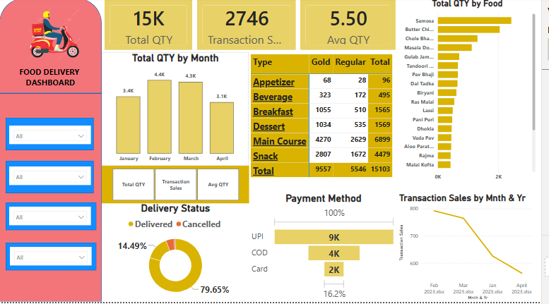

# Food Delivery Analytics Dashboard | Power BI
## Project Overview
This project focuses on analyzing food delivery business performance using Microsoft Power BI.
The dashboard provides insights into food sales, monthly quantity trends, food categories, payment methods, and delivery performance.
The objective is to help management understand business performance and make data-driven decisions.
## Tools & Technologies
- Microsoft Power BI
- Power Query
- DAX
- Data Visualization
- Data Analysis
- Data Modelling
## Dashboard Features
1. Total Quantity Analysis
2. Transaction Sales KPI
3. Average Quantity Analysis
4. Monthly Quantity Performance
5. Food Category Analysis
6. Gold vs Regular Category Analysis
7. Food-wise Quantity Analysis
8. Delivery Status Analysis
9. Payment Method Analysis
10. Monthly Transaction Sales Trend
## Key Business Insights
- Total food quantity is approximately 15K.
- Main Course is the highest-selling category.
- Snacks represent the second-highest category.
- February recorded the highest monthly quantity.
- UPI is the leading payment method.
- Delivery performance and cancellation rates
  can be monitored through the dashboard.
## Business Objectives
- Monitor overall food delivery performance.
- Identify high-performing food categories.
- Analyze monthly sales trends.
- Understand customer payment preferences.
- Monitor delivery and cancellation performance.
- Support management decision-making.
## Dashboard Preview

## Skills Demonstrated
- Data Cleaning and Transformation
- Power Query
- DAX Measures
- KPI Development
- Interactive Dashboard Design
- Business Analysis
- Data Visualization
## Author
Sangam Pagare
